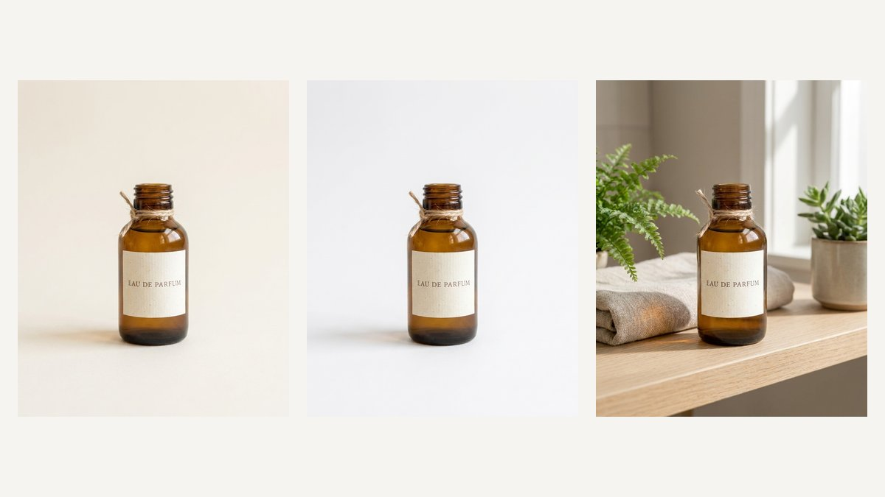
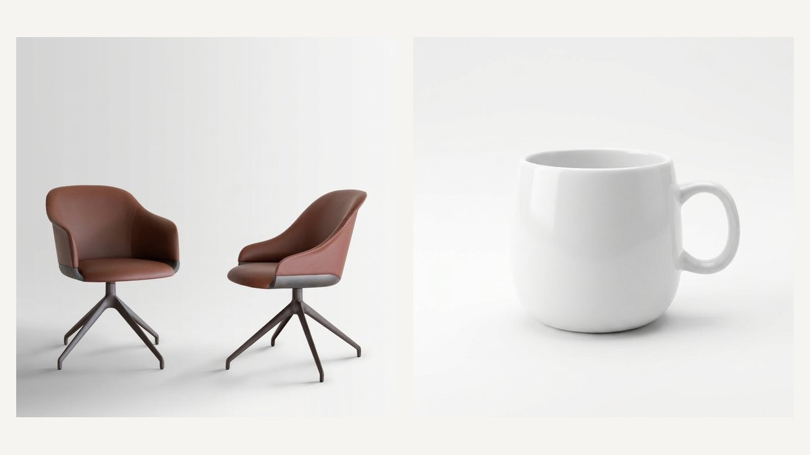

# DesignerBox Skills

[](https://github.com/designerboxai/skills/actions/workflows/validate-skills.yml)
[](https://github.com/designerboxai/skills/releases/latest)
[](./LICENSE)
[](#skills)
[](#claude-code-recommended)
[](https://designerbox.ai/docs/integrations/mcp)

Agent skills for product photos, marketplace listing sets and ad creatives with [DesignerBox](https://designerbox.ai). Give your assistant a product photo and it plans the shots, tells you the total cost in credits, asks you once, and saves every picture to your DesignerBox library.

Works with Claude Code, claude.ai, Codex, Cursor and other agents that load Markdown skills. The skills and the DesignerBox MCP server ship together as one plugin, `designerbox-studio`.



## Install

You need a [DesignerBox](https://designerbox.ai) account. The plugin connects to the DesignerBox MCP server at `https://mcp.designerbox.ai/api` and asks you to sign in. Step-by-step guide, including a non-technical walkthrough for claude.ai: [INSTALL.md](INSTALL.md). Agents can follow [INSTALL_FOR_AGENTS.md](INSTALL_FOR_AGENTS.md).

### Claude Code (recommended)

```
/plugin marketplace add designerboxai/skills
/plugin install designerbox-studio@designerbox
```

Or from a terminal:

```bash
claude plugin marketplace add designerboxai/skills
claude plugin install designerbox-studio@designerbox
```

Then run `/mcp` and sign in to `designerbox-studio`.

### claude.ai

1. Settings, Connectors, Add custom connector. Paste `https://mcp.designerbox.ai/api` and sign in.
2. Download `designerbox-studio-0.1.1.zip` from the [latest release](https://github.com/designerboxai/skills/releases/latest) and upload it as it is, without unzipping (Customize, Plugins, Upload).

You can also zip one skill folder and upload it as a skill, or paste a `SKILL.md` into a Project's instructions. Both are partial: rules that live in other skills' reference files (retry rules, call shapes) are lost, so the plugin is the supported path.

### gh skill (GitHub CLI 2.90+, skills only)

```bash
gh skill install designerboxai/skills --all --agent claude-code
```

Use `--agent` for your agent (`claude-code`, `codex`, `cursor` and others). This installs the skills only. Add the MCP server separately with the URL above.

### npx skills (skills only, cross-agent)

```bash
npx skills add designerboxai/skills
```

This installs the skills only. Add the MCP server separately with the URL above.

### Codex, Cursor and other hosts

Add an MCP server of type HTTP with the URL `https://mcp.designerbox.ai/api` (Codex: from [`mcp.json`](mcp.json), manifest [`.codex-plugin/plugin.json`](.codex-plugin/plugin.json)), then point the host at the `skills/` folder. Codex and Cursor are best effort, and Cursor sign-in is not supported yet.

## Skills

| Skill | Invoke in Claude Code | Use it when |
|---|---|---|
| [`designerbox-start-here`](skills/designerbox-start-here/SKILL.md) | `/designerbox-studio:designerbox-start-here` | The connector or upload path is not set up yet, or it is unclear which skill fits. It checks the connector, reads your credits, gets your photos in and hands off. It never generates. |
| [`designerbox-product-photos`](skills/designerbox-product-photos/SKILL.md) | `/designerbox-studio:designerbox-product-photos` | One product needs listing photos, a white-background main image, lifestyle scenes, extra angles, relighting, a flat lay or an on-model shot. |
| [`designerbox-batch`](skills/designerbox-batch/SKILL.md) | `/designerbox-studio:designerbox-batch` | The same treatment should run over several products: a list, a folder of photos, a CSV or a catalogue, with one total-cost confirmation. |
| [`designerbox-ads-social`](skills/designerbox-ads-social/SKILL.md) | `/designerbox-studio:designerbox-ads-social` | You want ad or social creatives for a product in one or more placement sizes (feed, story, Pinterest, square, banner), optionally in your brand style. |
| [`designerbox-refine`](skills/designerbox-refine/SKILL.md) | `/designerbox-studio:designerbox-refine` | A result came out wrong or needs one specific change: a colour, a label, a background, a misspelt word, a mood. |

You rarely need to invoke them by name: Claude picks the right skill from what you ask.

### What you can make

| Outcome | What you get | Skill |
|---|---|---|
| Listing set | A full set of store photos from one template: main, scenes, details | `designerbox-product-photos` |
| Clean white | The product on a plain white background, no added text | `designerbox-product-photos` |
| Lifestyle | The product in a real scene, with or without text | `designerbox-product-photos` |
| More angles | New views of the same product | `designerbox-product-photos` |
| Relight | The same photo with different studio light | `designerbox-product-photos` |
| Flat lay | Several products arranged from above on a surface | `designerbox-product-photos` |
| On a model | A person wearing or holding the product | `designerbox-product-photos` |
| Ad sizes | One ad in feed, story, Pinterest, square or banner sizes | `designerbox-ads-social` |
| Catalogue run | The same recipe over many products, one quote, a run record you can resume | `designerbox-batch` |
| One fix | Change only what came out wrong, quoted per attempt | `designerbox-refine` |



## Quick reference

| I want to... | Use |
|---|---|
| Connect DesignerBox or check my credits | `designerbox-start-here` |
| Make an Amazon or Etsy main image | `designerbox-product-photos` (Clean white) |
| Get a whole set of listing photos for one product | `designerbox-product-photos` (Listing set) |
| Put my product in a lifestyle scene | `designerbox-product-photos` (Lifestyle) |
| Show a garment or accessory on a person | `designerbox-product-photos` (On a model) |
| Make the same pictures for 10 or 100 products | `designerbox-batch` |
| Finish a batch that stopped | `designerbox-batch` ("finish my batch") |
| Make an ad for Instagram, Stories or Pinterest | `designerbox-ads-social` |
| Use my brand's tone and colours in an ad | `designerbox-ads-social` |
| Fix a wrong background, colour or label | `designerbox-refine` |

## Costs

DesignerBox generation uses your DesignerBox credits. Each skill reads the live price of the model it will use, works out the total, compares it with your balance and asks you once before anything is charged. A retry with the same request id within 30 minutes returns the first result instead of charging again, and a call the image service refuses costs nothing. Nothing here sets prices: the numbers come from your account at the time you ask.

## Next to the DesignerBox directory plugin

The `designerbox` plugin from the Claude directory (it can browse your library and designs but cannot generate) and `designerbox-studio` can be installed side by side. Only the connector at `https://mcp.designerbox.ai/api` can generate and read credits, and `designerbox-start-here` tells you if it is missing.

## Contributing

See [CONTRIBUTING.md](CONTRIBUTING.md). Release notes are in [CHANGELOG.md](CHANGELOG.md). Test scenarios for the skills are in [evals/scenarios.md](evals/scenarios.md).

## License

MIT, see [LICENSE](LICENSE). Questions: contact@designerbox.ai.
